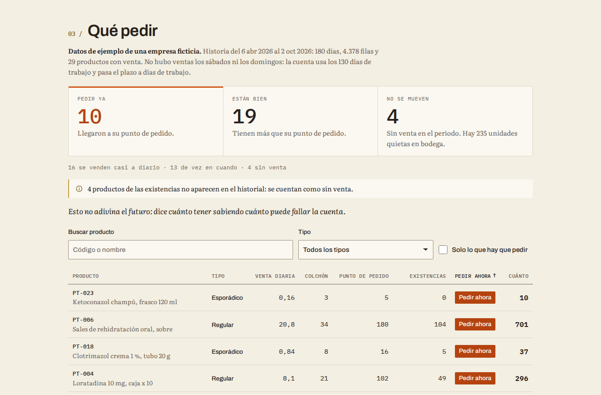
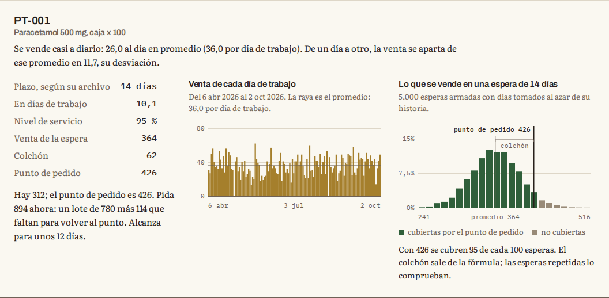
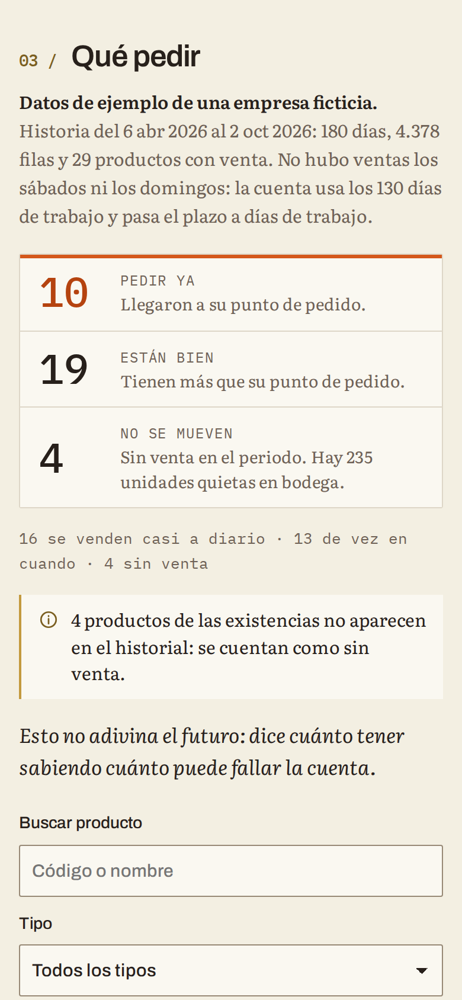

# Cuánto pedir

Qué productos pedir, cuánto y cuándo, a partir de su historial de ventas o de consumo. Es gratis, no hay
que instalar nada y sus datos no salen de su computador.

**Úsela aquí: [acbri.github.io/cuanto-pedir](https://acbri.github.io/cuanto-pedir/)**



*English summary at the end.*

## Qué hace

Usted sube un archivo con su historial: una fila por venta o por consumo, con la fecha, el producto y la
cantidad. La página responde, producto por producto:

- **Qué tipo de producto es:** se vende casi a diario, se vende de vez en cuando o no se vendió.
- **Cuánto colchón tener** para cubrir lo que la venta puede variar mientras llega el pedido.
- **En qué cifra pedir** (el punto de pedido): cuando lo que hay, más lo que viene en camino, baja a esa
  cifra, se pide.
- **Si hay que pedir hoy y cuánto**, si además sube las existencias de hoy.

Arriba resume cuántos productos hay que pedir ya, cuántos están bien y cuántos no se mueven. Al tocar un
producto se ve su venta de cada día y lo que se vendería en 5.000 esperas repetidas, con la raya del punto
de pedido. El resultado se descarga en CSV para abrirlo en Excel.

| Detalle de un producto que se vende a diario | En el teléfono |
| --- | --- |
|  |  |

## Cómo usarla

1. Abra [acbri.github.io/cuanto-pedir](https://acbri.github.io/cuanto-pedir/) en su navegador. También
   puede descargar esta carpeta (botón verde **Code**, luego **Download ZIP**), descomprimirla y abrir
   `index.html` con doble clic: funciona igual, y sin internet también, salvo para leer archivos de Excel.
2. Suba su historial. Para ver cómo funciona antes, toque **Usar datos de ejemplo**: es una empresa
   farmacéutica ficticia con 33 productos y 180 días de venta.
3. Revise las columnas que la página reconoció. Si alguna no es, elija la correcta en la lista.
4. Opcional: suba las existencias de hoy y el plazo de entrega de cada proveedor.
5. Ajuste el plazo de entrega, el nivel de servicio y el tamaño del lote. Cada valor trae uno razonable.
6. Lea la tabla. Lo que dice **Pedir ahora** ya llegó a su punto de pedido; la columna **Cuánto** dice
   cuánto pedir. Con **Solo lo que hay que pedir** y **Descargar esta lista en CSV** obtiene la lista para
   compras.

Para leer archivos de Excel, la página descarga un lector la primera vez que lo necesita. Sin internet,
guarde el archivo como CSV desde Excel (Archivo, Guardar como, CSV): el CSV se lee sin conexión.

## Cómo preparar el archivo

### El historial (obligatorio)

Tres columnas bastan: fecha, producto (o su código) y cantidad. Así es el archivo de ejemplo
([ejemplo-historial.csv](ejemplo/ejemplo-historial.csv)):

| fecha | documento | codigo | producto | cantidad |
| --- | --- | --- | --- | --- |
| 06/04/2026 | FAC-001-000004521 | PT-001 | Paracetamol 500 mg, caja x 100 | 10 |
| 06/04/2026 | FAC-001-000004522 | PT-001 | Paracetamol 500 mg, caja x 100 | 7 |
| 06/04/2026 | FAC-001-000004523 | PT-001 | Paracetamol 500 mg, caja x 100 | 14 |
| 06/04/2026 | FAC-001-000004524 | PT-002 | Ibuprofeno 400 mg, caja x 50 | 28 |

- Puede traer una fila por factura o una por día: las filas del mismo producto y del mismo día se suman.
- Las columnas de más se ignoran.
- Las columnas se reconocen por su nombre (fecha, producto, código, referencia, artículo, cantidad,
  unidades y sus equivalentes en inglés y en Odoo o SAP Business One). Si el nombre no dice nada, se
  reconocen por lo que contienen.
- Fechas en cualquiera de los formatos de siempre: 06/04/2026, 2026-04-06, 6-abr-2026, el número de fecha de
  Excel. Si vienen como mes/día/año, se detecta solo.
- Decimales con coma o con punto: 2,5 o 2.5. Sirve para kilos y litros.
- Las cantidades negativas (devoluciones) no se cuentan. Si todas vienen en negativo, como las salidas de un
  kárdex, se toman en positivo.
- CSV con coma, punto y coma o tabulador; en UTF-8 o en la codificación que usa Excel en Windows.

Funciona bien con seis meses a un año de historia; con menos de 60 días la cuenta es poco confiable y la
página lo avisa.

### Existencias de hoy (opcional)

Una fila por producto con sus existencias, como
[ejemplo-existencias.csv](ejemplo/ejemplo-existencias.csv). Si trae una columna con lo que ya viene en
camino (pedidos hechos y no recibidos), también se cuenta. Si un producto aparece en varias filas (una por
bodega o por lote), se suman. Los productos que estén aquí y no en el historial se cuentan como sin venta:
así aparece la mercadería quieta.

### Plazo de cada proveedor (opcional)

Una fila por producto con los días que tarda en llegar desde que se pide, como
[ejemplo-plazos.csv](ejemplo/ejemplo-plazos.csv). Los productos que no estén usan el plazo general.

### Desde su sistema

- **Odoo.** Historial: Inventario, Informes, Historial de movimientos; deje solo las salidas a clientes (o
  los consumos de producción), seleccione todo y use Acción, Exportar con Fecha, Producto y Cantidad. El
  producto sale como «[PT-001] Paracetamol»; la página separa el código del nombre. Existencias: Inventario,
  Productos, en la vista de lista, exporte Referencia interna, Cantidad a mano y, si quiere, Entrante. Plazos:
  Compras, Configuración, Listas de precios de proveedores, con Producto y Plazo de entrega. Los nombres de
  menú cambian un poco entre versiones.
- **SAP Business One.** Historial: una consulta sobre las líneas de factura de clientes (tabla INV1, campos
  DocDate, ItemCode, Dscription y Quantity) exportada a Excel; esos nombres se reconocen tal cual.
  Existencias: los artículos (OITM) con ItemCode, OnHand y OnOrder, que es lo pedido a proveedores. El plazo
  está en LeadTime.
- **Excel.** Una hoja con las tres columnas. Si el libro tiene varias hojas, se usa la que tenga las
  columnas reconocidas, y se puede cambiar.

## Qué significa cada columna del resultado

| Columna | Qué dice |
| --- | --- |
| Producto | El código o el nombre que trae su archivo. |
| Tipo | **Regular** si se vende casi a diario, **Esporádico** si se vende de vez en cuando, **Sin venta** si no se vendió en el periodo. |
| Venta diaria | Lo vendido en el periodo dividido entre los días corridos, fines de semana incluidos. |
| Colchón | Lo que se tiene de más para cubrir lo que la venta puede variar mientras llega el pedido. |
| Punto de pedido | Cuando lo que hay, más lo que viene en camino, baja a esta cifra, se pide. |
| Existencias | Lo que hay hoy según su archivo; debajo, lo que viene en camino. |
| Pedir ahora | **Pedir ahora** si ya llegó al punto de pedido; **Bien** si no; **No se pide** si no tiene venta. |
| Cuánto | Un lote (por defecto, un mes de venta) más lo que falte para volver al punto de pedido. |

El CSV que se descarga trae además el lote, el plazo y el nivel de servicio de cada producto, cada cuántos
días sale y cuántas salen cuando sale, y la fecha de la última venta.

## Cómo se calcula

Para cada producto, tres preguntas: cuánto se vende mientras llega el pedido, cuánto puede fallar esa cifra
y qué cuesta más, que falte o que sobre.

**Qué tipo de producto es.** Si no se vendió en el periodo, no se pide. Si entre un día con venta y el
siguiente pasan en promedio más de 1,32 días, se vende de vez en cuando. Si no, se vende casi a diario.

**Los que se venden casi a diario.** Se suma la venta de los días que tarda el proveedor y se agrega un
colchón. El colchón crece con lo irregular de la venta y con lo que tarda el proveedor:

```
venta de la espera = venta diaria × días de plazo
colchón            = z × desviación diaria × √(días de plazo), redondeado hacia arriba
punto de pedido    = venta de la espera + colchón
```

La desviación mide cuánto cambia la venta de un día a otro. El factor z sale del nivel de servicio: 1,645
para el 95 %. Con 4 al día, desviación 2 y 10 días de plazo: 40 + 11 = 51.

**Los que se venden de vez en cuando.** Aquí el promedio engaña: un producto que sale una vez por semana no
se vende un poquito cada día. Se repite la historia: se toman al azar tantos días del historial como dura la
espera y se suman. Eso se hace 5.000 veces, siempre con la misma semilla para que el resultado no cambie de
una vez a otra, y el punto de pedido es la cifra que cubre el nivel de servicio en esas esperas: con 95 %,
la que alcanzó en 95 de cada 100. Para estos productos la página muestra también cada cuántos días sale y
cuántas salen cuando sale.

**El nivel de servicio, si prefiere sacarlo de los costos.** Conviene tener producto mientras guardar una
unidad durante un lote cueste menos que el margen que se pierde si falta:

```
nivel de servicio = 1 − (costo de guardar una unidad durante un lote ÷ margen por unidad)
```

Guardar se calcula como el 25 % del costo al año (bodega, dinero quieto, vencimientos y mermas). Con margen de
1,00 y guardar un mes a 0,05: 1 − 0,05 ÷ 1,00 = 95 %. Si elige «Lo calculo con margen y costo» y su archivo de
existencias trae el costo y el precio de cada producto, cada uno tiene su propio nivel.

**Cuándo y cuánto pedir.** Se pide cuando las existencias, más lo que viene en camino, no pasan del punto
de pedido. Se pide un lote, que por defecto es un mes de venta, más lo que falte para volver al punto.

**Los días de trabajo.** Si la empresa no vende ciertos días de la semana, como sábados y domingos, esos días
no cuentan como días sin venta: la cuenta usa los días de trabajo y pasa el plazo a días de trabajo. Así, un
producto que se vende todos los días hábiles no se confunde con uno que se vende de vez en cuando.

## Privacidad

- Todo se calcula en su navegador. La página no tiene servidor, no pide cuentas y no guarda sus archivos.
- Una regla de seguridad del navegador (la directiva `connect-src 'none'` de su Content-Security-Policy) le
  prohíbe a la página enviar datos a cualquier parte. Lo único que descarga son las tipografías, de Google
  Fonts. El lector de Excel va dentro de la página (en `vendor/sheetjs/`), así que no se baja de ningún otro
  sitio y funciona sin internet.
- Lo único que la página recuerda, en su propio navegador, es si usted eligió el modo claro o el oscuro.

## Limitaciones

- No adivina el futuro: dice cuánto tener sabiendo cuánto puede fallar la cuenta. Supone que la venta de los
  próximos meses se parece a la del historial, así que no ve temporadas, promociones, productos nuevos ni
  cambios de precio. Si su venta cambió, elija en «Historia que se usa» solo los últimos meses.
- Con menos de 60 días de historia, la cuenta es poco confiable.
- Un producto que entró a la venta a mitad del periodo se cuenta como si no se hubiera vendido antes.
- Supone que el plazo del proveedor es fijo. Si a veces se demora el doble, súbalo.
- No sabe de vencimientos, pedidos mínimos, múltiplos de empaque ni espacio en bodega: ajuste la cifra con lo
  que usted sabe.
- Cuenta todas las bodegas juntas.

## Para quien quiera revisar el código

| Archivo | Qué tiene |
| --- | --- |
| `index.html`, `estilos.css`, `app.js` | La página |
| `calculo.js` | Toda la cuenta y la lectura de archivos, sin pantalla; corre igual en el navegador y en Node |
| `ejemplo.js` | La empresa ficticia; `ejemplo/` son sus archivos |
| `pruebas/` | Las pruebas del cálculo y la prueba de punta a punta |

Las pruebas del cálculo usan el corredor de Node, sin dependencias:

```bash
node --test
```

La prueba de punta a punta abre la página en un Chromium sin cabeza, con doble clic y servida por HTTP, en
escritorio, teléfono y modo oscuro, y deja las capturas en `docs/capturas/`:

```bash
npm install
npm run punta
```

Para publicarla en GitHub Pages: Settings, Pages, Deploy from a branch, rama `main`, carpeta raíz.

## Licencia y créditos

Licencia MIT: puede usarla, copiarla y cambiarla, también en su empresa. Vea [LICENSE](LICENSE).

Hecho por Andrés Briñez · [andresbrinez.com](https://andresbrinez.com)

- [SheetJS Community Edition](https://sheetjs.com) 0.20.3 lee los archivos de Excel; va copiado en
  `vendor/sheetjs/` con su licencia (Apache 2.0).
- Tipografías Archivo, Literata e IBM Plex Mono, de Google Fonts (SIL Open Font License).

---

## In English

**Cuánto pedir** ("how much to order") is a free, open-source web page that tells a mid-size company which
products to reorder, how much and when, from its sales or consumption history. Open
[acbri.github.io/cuanto-pedir](https://acbri.github.io/cuanto-pedir/) or download this folder and
double-click `index.html`; nothing to install. Everything runs in the browser and a Content-Security-Policy
(`connect-src 'none'`) forbids the page from sending data anywhere.

Upload a CSV or Excel file with date, product and quantity per row; columns are detected by name (Spanish,
English, Odoo and SAP Business One names) or by content, and can be corrected. Optional files add today's
stock, quantities on order and each supplier's lead time. For each product the page classifies demand as
regular, intermittent (average interval between demand days above 1.32) or without sales, and computes:

- **Regular:** safety stock = z × daily standard deviation × √lead time, rounded up; reorder point = mean
  demand over the lead time + safety stock.
- **Intermittent:** lead-time demand is bootstrapped by summing randomly drawn days of history 5,000 times
  with a fixed seed; the reorder point is the service-level percentile.
- **Service level from costs:** α = 1 − hQ/(bD), holding one unit for one lot cycle against the margin lost
  per unit short.
- **Order now** when stock plus on-order ≤ reorder point; order one lot (one month of demand by default) plus
  whatever is missing to get back to the reorder point.

Weekdays without activity (for example weekends) are detected and excluded, and the lead time is converted to
working days. Unit tests run with `node --test`; the end-to-end test drives headless Chromium with
`npm run punta`. MIT license, by Andrés Briñez ([andresbrinez.com](https://andresbrinez.com)).
